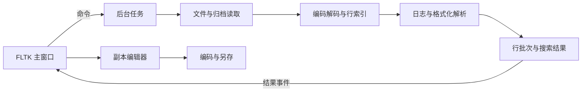

# minecraft-logs-viewer 架构与实施计划

minecraft-logs-viewer 是一个本地桌面日志工作台。用户打开一个目录，在单个窗口中浏览普通文件与归档日志、搜索问题、查看上下文，并创建副本进行编辑和导出。

应用代码统一使用 Rust，界面使用 FLTK，归档读取使用 libarchive。目录扫描、后台任务、文件读写和缓存管理使用 Rust 标准库。Windows、macOS 和 Linux 共用日志处理与界面代码，平台差异集中处理。

## 产品目标

| 目标 | 要求 |
| --- | --- |
| 单窗口操作 | 目录、日志、搜索结果和编辑副本保留在同一主窗口中 |
| 统一日志来源 | 普通文件、压缩日志和归档成员采用一致的浏览与搜索方式 |
| 完整来源定位 | 每个结果能够回到原始来源、成员和行号 |
| 原文保留 | 解析、编码转换和格式化显示保留与原始内容的关联 |
| 大文件可用 | 按范围读取和绘制日志，内存占用由缓存与结果上限控制 |
| 副本编辑 | 创建独立副本进行编辑，另存时保留或明确选择编码与换行 |
| 三端支持 | Windows x64、macOS arm64 与 x64、Linux x64 |
| 小体积发布 | 每个平台发行包小于 15 MB，优化目标小于 10 MB；应用本体优先控制到个位数 MB |

应用本体与发行包分别记录体积。随应用分发的原生库、资源和许可文件计入发行包；操作系统提供的标准运行库单独列出运行条件。macOS 两种架构分别构建和发布。

## 功能需求

### 目录与来源管理

支持通过文件选择器或拖放打开目录，提供子目录扫描开关、手动刷新、按名称或日期排序及来源多选。扫描过程逐步展示已发现来源，显示当前进度与失败项。

普通文件显示名称、相对位置、大小和变化状态。归档显示其成员，成员保留完整内部路径与序号。来源时间包括日志中明确记录的时间、由文件名推断的日期和未知时间，三种情况分别标识。

### 支持格式与归档范围

| 来源 | 读取方式与支持范围 |
| --- | --- |
| `.log`、`latest.log` | 分块读取普通文件 |
| `.log.gz` | 解压单个 gzip 数据流后读取日志 |
| `.tar` | 枚举 TAR 成员并读取目标日志 |
| `.tar.gz`、`.tgz` | 顺序解压并枚举 TAR 成员 |
| `.zip` | 读取常见 Stored 与 Deflate 压缩的日志成员 |
| `.7z` | 读取常见未加密的 LZMA 与 LZMA2 归档 |
| `.rar` | 读取常见未加密 RAR4 与 RAR5 归档，固实压缩按真实样本验收 |

归档成员匹配以下位置的 `.log` 与 `.log.gz` 文件：

```text
backup.zip/latest.log
backup.zip/2026-10-12.log.gz
backup.zip/logs/latest.log
backup.zip/logs/2026-10-12.log.gz
```

同一规则适用于其他归档格式：读取归档根目录，以及根目录下 `logs/` 的直接子文件。比较扩展名时忽略大小写，保留原始成员路径。成员路径中的相对路径前缀在匹配前规范化，路径越界和非普通文件成员作为无效来源处理。

libarchive 的具体格式能力取决于构建版本和解码依赖。首版兼容表以上述常见算法为基础；加密 7z 和加密 RAR 不计入首版支持范围。其他压缩算法、分卷归档和特殊变体根据样本验证结果明确标注，失败时显示具体原因。

### 日志浏览

提供行号、等宽字体、水平滚动、跳转行号、选中行复制和上下文查看。大日志按可见范围读取，行数与索引在后台逐步建立。超长行在预览中限制绘制长度，完整内容通过单行详情或复制取得。

识别常见 Minecraft 日志的时间、线程、级别、logger 和消息内容。无法识别的行保持可见、可搜索和可复制。多行异常保留全部原始行，分组和折叠依据已识别的异常结构完成。

文件内部保持原始顺序。跨来源结果默认按来源与行号展示，时间排序只使用明确标识过的时间依据。

### 搜索与过滤

支持当前日志、选中来源和整个目录三种搜索范围，包含符合归档范围规则的全部日志成员。

提供原文子串、大小写选项和逐行正则搜索，以及级别、线程、logger 和时间范围过滤。默认搜索可见文本，提供原文搜索开关。正则采用 Rust `regex` 的语法，输入错误在开始扫描前报告。

结果包含来源、成员、原始行号、命中范围和上下文。点击结果后打开来源并定位，搜索结果标签页保留。正则与字段过滤在 Rust 后台处理。

结果按批次返回。首版展示上限为 10,000 条命中行，达到上限后结束任务并明确标记结果已截断；用户可缩小范围重新搜索。状态区分扫描完成、用户取消、结果截断和部分来源失败，只有全部目标来源扫描成功才显示完整结果。

### Minecraft 格式化字符

按照 Minecraft Java 的规则处理以下格式：

| 字符 | 效果 |
| --- | --- |
| `§0` 至 `§9`、`§a` 至 `§f` | 16 种颜色 |
| `§k` | 混淆文字 |
| `§l` | 粗体 |
| `§m` | 删除线 |
| `§n` | 下划线 |
| `§o` | 斜体 |
| `§r` | 重置颜色与样式 |

格式化解析输出可见文本与样式片段，并维护可见位置到原文位置的映射。颜色切换、组合样式和重置按顺序生效。无效或不完整的控制序列保留在原文中；读取分块边界不截断解析状态。

浏览视图隐藏有效控制码并绘制样式。编辑器显示包含控制码的原文，提供格式化预览。混淆文字默认展示真实字符，用户可开启混淆预览；预览仅作用于可见内容，搜索和复制始终使用真实字符。

例如，原文 `§aABC§bDEF` 的可见文本为 `ABCDEF`，搜索 `ABCDEF` 可以跨越控制码命中，并映射回正确的原文区间。

### 编码识别

每份日志在取得解压后的字节后独立识别编码。归档成员文件名的编码由归档格式规则处理，与日志内容编码分开。

识别顺序如下：

1. 检查 BOM，识别 UTF-8、UTF-16LE 和 UTF-16BE。
2. 无 BOM 时增量校验 UTF-8；纯 ASCII 内容标记为兼容 UTF-8，后续继续校验。
3. UTF-8 校验失败时，通过 `chardetng` 提出候选编码。
4. 对无 BOM 的 UTF-16，根据字节分布提供候选，并允许用户手动确认。
5. 使用选定编码进行增量解码，向界面提供 UTF-8 文本。

常用手动选项包括 UTF-8、UTF-16LE、UTF-16BE、GBK、GB18030、Big5、Shift_JIS 和 Windows-1252。界面显示当前编码、识别依据和解码错误提示；自动猜测显示为可能的编码，不显示未经校准的概率。

编码检测以有界样本启动，并在后续读取中继续验证。切换编码后重新生成解码文本、行索引与搜索结果位置。遇到错误字节时，浏览视图显示可见标记，原始字节保留；保存前要求解决解码错误或明确选择转换输出。

### 副本编辑与导出

支持从完整日志、选中行或搜索结果上下文创建副本。副本在主窗口标签页中编辑，具有修改状态、撤销、重做、查找替换和关闭前的未保存提示。

整文件编辑初始上限为 20 MiB，超过时提供片段副本；该阈值在原型中根据实际内存和交互表现调整。副本创建后固定内容，来源后续变化不混入编辑文档。

另存时显示输出编码、BOM、换行方式和末尾换行信息。默认保留来源设置，也允许明确转换。UTF-16 输出使用 Rust 标准库编码处理。所选编码无法表示新增字符时，提示选择其他编码。

保存时检查目标路径和文件身份，确认不会通过路径别名覆盖来源原件。覆盖已有副本前检查目标变化，先完成临时文件写入，再使用平台支持的替换操作；失败时保留已有目标并报告错误。

导出提供两种内容：保持原文的日志片段，以及包含来源和行号的搜索结果列表。原文导出不自动插入来源说明。

### 实时跟踪与本地状态

`latest.log` 支持跟随末尾、暂停跟随和恢复。跟踪任务根据文件身份、长度和读取偏移处理追加、截断、替换、重命名与轮转。未完成的一行或多字节字符暂存，收到后续字节再解析。

普通搜索固定任务开始时各来源的读取范围。搜索期间产生的新日志通过重新搜索查看，搜索任务能够明确结束。

本地状态包括窗口布局、主题、字体、阅读位置、书签和最近目录。状态存放在平台用户数据目录，与可重建缓存分开。缓存提供容量限制和清理入口，清理只影响应用管理的缓存。

## 技术栈

| 组成 | 选择 | 职责 |
| --- | --- | --- |
| 应用语言 | Rust | 界面逻辑、日志处理、任务、搜索、编辑与保存 |
| 原生界面 | `fltk` | 窗口、布局、资源树、表格、编辑器和系统交互 |
| 归档读取 | `compress-tools` 与 libarchive | 成员枚举、分块读取与单流解压 |
| 正则 | `regex` | 正则搜索和日志前缀识别 |
| 编码转换 | `encoding_rs` | 增量解码与支持编码的输出 |
| 编码检测 | `chardetng` | 无明确编码信息时提出候选 |
| 线程与通道 | `std::thread`、`std::sync` | 后台任务、取消与结果传递 |
| 文件与缓存 | `std::fs`、`std::io` | 目录扫描、分块读取、临时文件与副本保存 |
| 状态序列化 | `serde`、`serde_json` | 本地设置与书签持久化阶段接入 |

应用源码使用 Rust，FLTK 和 libarchive 是构建时的原生依赖。各平台构建需要 Rust、C/C++ 工具链及相应原生库构建环境。依赖版本由 Cargo 清单与锁文件固定，原生解码库版本和构建选项同时记录。

`compress-tools` 接入构建环境提供的 libarchive。构建流水线先准备固定版本、对应架构的 libarchive 与解码库，再完成发现和链接；Windows MSVC 使用 vcpkg，macOS 与 Linux 使用 pkg-config。macOS arm64 单独验收依赖发现、原生库链接和样本读取。

FLTK 保留 Linux 的 Pango 与中文字体支持。界面以原生控件和系统字体组成，按实际需求启用图像功能。归档依赖使用同步读取接口，在后台线程运行；所需压缩算法直接链接解码库。

## 应用架构

### 主线程与后台任务

主线程持有全部 FLTK 控件，处理输入、绘制、标签页和文档状态。后台任务负责目录扫描、归档读取、解码、建立索引、搜索与保存。

采用标准库线程与有界通道。扫描、读取和搜索各保留至多一个活动任务，同类新请求取消旧任务。任务独立持有文件或归档读取器，后台线程只返回数据，不操作控件。

后台结果携带任务标识与来源版本。主线程只接受仍属于当前操作的结果，避免旧搜索或旧来源批次覆盖新视图。取消状态通过共享标志传递，读取循环在分块边界检查，满通道等待时也可退出。后台发送结果后唤醒主事件循环，界面按批次更新。



### 模块职责

| 模块 | 职责 |
| --- | --- |
| `app` | 应用状态、来源选择、标签页与任务生命周期 |
| `ui` | 主窗口、布局、资源树、查看器、结果表格和编辑器 |
| `worker` | 命令、结果事件、线程、取消与批次传递 |
| `source` | 目录扫描、来源身份、来源版本与归档成员匹配 |
| `archive` | libarchive 接入、成员枚举、压缩日志与分块读取 |
| `text` | 编码识别、增量解码、行切分、定位与索引 |
| `format` | `§` 解析、样式片段与原文位置映射 |
| `search` | 搜索范围、匹配、字段过滤与结果定位 |
| `document` | 编辑副本、修改状态、编码与换行设置 |
| `save` | 副本保存、覆盖检查与导出 |
| `cache` | 按需展开文件、解码缓存、容量与清理 |
| `platform` | 用户数据目录、文件替换及必要的平台差异 |

首版使用一个 Cargo 项目。模块只承载表中职责，界面组件随着实现拆分。拟定目录结构如下：

```text
minecraft-logs-viewer/
  Cargo.toml
  Cargo.lock
  README.md
  docs/
    architecture-and-plan.md
  src/
    main.rs
    app.rs
    worker.rs
    source.rs
    archive.rs
    text.rs
    format.rs
    search.rs
    document.rs
    save.rs
    cache.rs
    platform.rs
    ui/
      mod.rs
      viewer.rs
      results.rs
      editor.rs
  tests/
    fixtures/
```

### 数据模型

| 对象 | 内容与约束 |
| --- | --- |
| `LogSource` | 一份可独立浏览的日志，记录来源标识、容器、成员路径与序号、元数据和版本 |
| `SourceRevision` | 来源身份与变化代次，用于识别定位和缓存是否仍然有效 |
| `LineRef` | 来源标识、来源版本、原始行号和原始内容范围 |
| `DecodedLine` | UTF-8 原文、原始行引用、换行信息和解码状态 |
| `LogRecord` | 原始行范围及可选时间、线程、级别、logger、消息与异常分组 |
| `StyledLine` | 可见文本、样式片段及可见位置到原文位置的映射 |
| `SearchHit` | 原始行引用、搜索模式、命中范围、摘要和上下文 |
| `EditDocument` | 固定的副本内容、修改状态、输出编码、BOM 与换行信息 |
| `TaskState` | 任务标识、操作类型、进度、取消状态、失败来源和结果完整性 |

归档成员身份由容器、成员路径和成员序号共同确定。重名成员分别显示。FLTK 文本位置按 UTF-8 字节边界处理，原始文件字节位置、解码文本位置和可见文本位置分别维护。

### 界面组成

| 区域 | 控件与行为 |
| --- | --- |
| 顶部 | 目录入口、搜索输入、范围和字段过滤 |
| 左侧 | `Tree` 显示普通日志、归档与成员 |
| 中央 | `Tabs` 显示日志、搜索结果和编辑副本 |
| 右侧 | 可折叠来源信息、解析字段和书签 |
| 底部 | 扫描进度、搜索状态、编码、行号与跟踪状态 |

使用 `Flex` 与 `Tile` 组织布局，使用 `Table` 或 `TableRow` 绘制日志和结果。副本编辑使用 `TextEditor` 与 `TextBuffer`，文件选择、复制与粘贴使用 FLTK 提供的能力。

## 读取与定位

普通 UTF-8 日志可直接在原文件上建立稀疏行索引。索引记录部分行的起始位置，跳转时从最近的检查点继续读取；索引建设不阻塞首屏显示。

其他编码在增量解码后建立行定位信息。需要随机访问时，将解码后的 UTF-8 文本按需缓存，索引建立在正确的解码行边界上。切换编码使相关索引失效。

压缩流与固实归档采用顺序读取。首次打开所选日志时逐步产生可用行，按需缓存该成员供后续定位。归档内的 `.log.gz` 先暂存所选成员的压缩字节，再执行单流解压，保留外层来源关联。

全目录搜索按容器组织扫描，同一归档中的目标成员在一次读取过程中处理。部分格式即使只读取目标日志，也需要先解压前面的数据，进度据实际读取量更新。

首次索引未完成时，只允许跳转到已知范围，或启动可取消的定位任务继续扫描；界面区分未知总行数和已完成的行数统计。

## 文本显示与编辑

大日志查看器只取得可见范围附近的行，绘制行号、级别、样式片段和命中高亮。选择以原始行引用维护，复制或创建片段副本时重新取得完整内容。绘制长度限制不改变搜索和导出内容。

`TextBuffer` 用于已固定且受大小限制的编辑文档。查找替换、撤销重做与保存状态属于文档自身，不修改来源定位。编辑器的格式化预览复用同一 `§` 解析器。

字体选择系统等宽字体，并保留中文回退。格式化解析与主题颜色分开，颜色和字体样式由绘制层映射。混淆预览不改变文档内容。

## 文件与缓存边界

目录扫描首版不跟随符号链接，归档只读取普通文件成员。缓存文件由应用生成名称，成员内部路径仅用于识别和展示。应用限制单次解压、缓存容量、结果数量和界面批次大小。

损坏归档、校验失败、未知算法、无权限、磁盘空间不足和来源变化均作为明确失败报告。部分来源成功时保留可用结果，并显示未完成范围。

读取过程中遇到来源截断或替换，取消相关定位并刷新来源版本。缓存与搜索结果带有来源版本，过期定位要求重新打开或搜索。

原始日志目录保持浏览状态。副本和导出目标由用户选择，程序确认目标不会覆盖来源原件。运行状态、最近目录与缓存放在平台用户数据目录，开发仓库不保存个人日志和运行配置。

## 三端构建与发布

| 平台 | 目标 | 发行方式 | 运行条件 |
| --- | --- | --- | --- |
| Windows | `x86_64-pc-windows-msvc` | EXE 与 ZIP 或小型安装包 | Windows 10 与 11，所选构建的标准运行库 |
| macOS Apple Silicon | `aarch64-apple-darwin` | APP 与 ZIP 或 DMG | 由工具链与原型测试确定最低系统版本 |
| macOS Intel | `x86_64-apple-darwin` | APP 与 ZIP 或 DMG | 与 arm64 分别验证 |
| Linux | `x86_64-unknown-linux-gnu` | DEB、RPM 或二进制压缩包 | X11、Pango、Cairo 等所选 FLTK 构建依赖 |

Linux 首轮基线为 Ubuntu 22.04 与 Debian 12，后续按发行方式验证其他系统。FLTK 按目标架构构建，libarchive 与必要解码库由流水线提前准备并链接；所需的非系统动态库随包分发，系统标准库可动态链接。每个平台使用一致的格式功能配置，随包动态库计入应用体积，运行条件分别列出系统组件与随包原生库。

Rust Release 配置从尺寸优化开始，原型同时检查读取、解压和搜索速度：

```toml
[profile.release]
opt-level = "s"
lto = true
codegen-units = 1
strip = true
```

各平台分别构建、测试和记录应用本体与发行包大小。发行包必须小于 15,000,000 字节，优化目标小于 10,000,000 字节。符号和调试文件单独保存，发行包附第三方许可文件。

## 实施计划

### 里程碑一 体积与兼容性原型

建立 Cargo 项目并接入 FLTK、libarchive 绑定、正则、编码转换和检测。原型包含窗口、表格绘制、文本编辑器及真实解码调用，确保这些能力参与最终链接。

验证普通日志、gzip、TAR.GZ、ZIP、7z、RAR4 与 RAR5 的小型样本，验证中文、UTF-16、常见中文编码和 `§` 样式。先验证各目标的原生库发现与链接，包含 macOS arm64；分别构建四个目标架构并记录 Release 本体、随包库与压缩发行包大小。

完成条件：所有目标完成最小窗口和编辑器运行；基础归档样本读取正确；中文显示与输入可用；发行包满足体积上限，具体算法和系统依赖有记录。

### 里程碑二 来源与日志浏览

实现目录扫描、归档成员筛选、来源模型、编码选择、分块读取、行索引和按需缓存。完成资源树、日志标签页、虚拟行绘制、行号定位、复制、常见字段解析与 `§` 格式化显示。

完成条件：所有支持来源都能打开；原始行顺序与内容保持一致；已索引范围能够正确跳转；来源切换不会被旧批次覆盖；大文件操作可取消。

### 里程碑三 跨来源搜索

实现三种搜索范围、子串与逐行正则、原文与可见文本模式、字段过滤、批次结果、上下文和点击定位。完成结果上限、取消和部分失败状态。

完成条件：相同文本在普通文件与不同归档中都能命中；控制码两侧文本可连续匹配；中文位置正确；来源变化后不使用过期结果；完成、取消、截断与部分失败可以区分。

### 里程碑四 副本编辑与保存

实现全文和片段副本、编辑标签页、撤销重做、查找替换、修改提示、格式化预览、编码与换行选择、另存和两种导出格式。

完成条件：原始文件与归档字节保持一致；副本内容固定；保存失败保留已有目标；无法表示的字符和解码错误得到明确处理；关闭修改文档时提示保存。

### 里程碑五 实时跟踪与三端发布

实现 `latest.log` 跟踪、暂停、追加、截断与轮转处理，接入书签、阅读位置、窗口设置和缓存清理。配置三端持续集成、发行体积门槛、许可文件与打包。

完成条件：实时跟踪不会重复或遗漏完整行；多字节字符分块正确；各平台通过功能样本与界面检查；发行体积、格式支持表和运行条件与实际产物一致。

## 验证与验收

### 样本原则

仓库内只保存人工构造或经过明确授权的测试样本。普通日志、归档和编码样本放在 `tests/fixtures/`，覆盖每个承诺支持的算法；运行日志、个人目录记录和真实服务器数据存放在仓库之外。

### 功能验收

| 场景 | 通过标准 |
| --- | --- |
| 中文与特殊字符路径 | 能扫描、打开、搜索和另存 |
| 根目录与 `logs/` 成员 | 两种位置读取正确，范围规则一致 |
| 重名归档成员 | 分别识别，命中定位不会混淆 |
| 空文件与无末尾换行 | 内容与行定位正确 |
| UTF-8、UTF-16 与中文编码 | 检测、手动切换、搜索和副本保存正确 |
| 格式化跨分块 | 控制序列和多字节字符不被截断 |
| 格式化搜索 | 可见文本命中可映射到完整原文区间 |
| 固实归档后部成员 | 内容正确，读取进度与定位行为明确 |
| 损坏或不支持的归档 | 明确显示原因，搜索完整性状态正确 |
| 大日志与超长行 | 界面可继续操作，预览限制不影响搜索与复制 |
| 取消与快速切换 | 旧任务停止，不覆盖新视图 |
| 副本保存 | 原件保持不变，失败不损坏已有目标 |
| 日志追加与轮转 | 完整行按顺序显示，截断与替换正确处理 |
| 三端输入与显示 | 中文输入、字体、复制粘贴和平台快捷键可用 |

### 性能记录

原型使用小型日志、100 MiB 普通日志、1 GiB 普通日志，以及包含多个成员的归档进行测试。分别记录首屏时间、冷读取与重复定位时间、搜索吞吐、取消响应、峰值内存和缓存大小。

界面在读取、解压和搜索期间保持可操作，取消在分块处理后及时生效。内存由读取窗口、索引、编辑文档和结果上限控制，避免随全部日志原文总量增长。验收报告附测试平台、样本大小和构建配置。

### 工程检查

实现阶段执行格式检查、静态检查、针对行为的测试和各平台 Release 构建。测试重点覆盖来源定位、编码边界、格式化映射、搜索状态、文件保存和轮转行为。

每次构建成功后，执行 BetterLeaks 工作树扫描，覆盖源码、脚本、可提交配置与新增文件，并启用输出脱敏。Windows 上出现正则引擎缓存移动错误时使用标准库正则引擎重跑。只有扫描完成且退出码为零，才记录为通过。

发布验收同时核对依赖锁定、第三方许可、三端运行条件、归档支持表和体积门槛。

## 技术参考

- [FLTK Table 可见单元格绘制](https://www.fltk.org/doc-1.4/classFl__Table.html)
- [FLTK TextBuffer 文档缓冲区](https://www.fltk.org/doc-1.4/classFl__Text__Buffer.html)
- [FLTK TextEditor 编辑能力](https://www.fltk.org/doc-1.4/classFl__Text__Editor.html)
- [fltk-rs 平台与构建说明](https://github.com/fltk-rs/fltk-rs)
- [libarchive 格式与读取模型](https://github.com/libarchive/libarchive)
- [compress-tools 流式归档接口](https://docs.rs/compress-tools/latest/compress_tools/)
- [Rust regex 搜索语法](https://docs.rs/regex/latest/regex/)
- [encoding_rs 编码转换](https://docs.rs/encoding_rs/latest/encoding_rs/)
- [chardetng 编码识别边界](https://github.com/hsivonen/chardetng)
